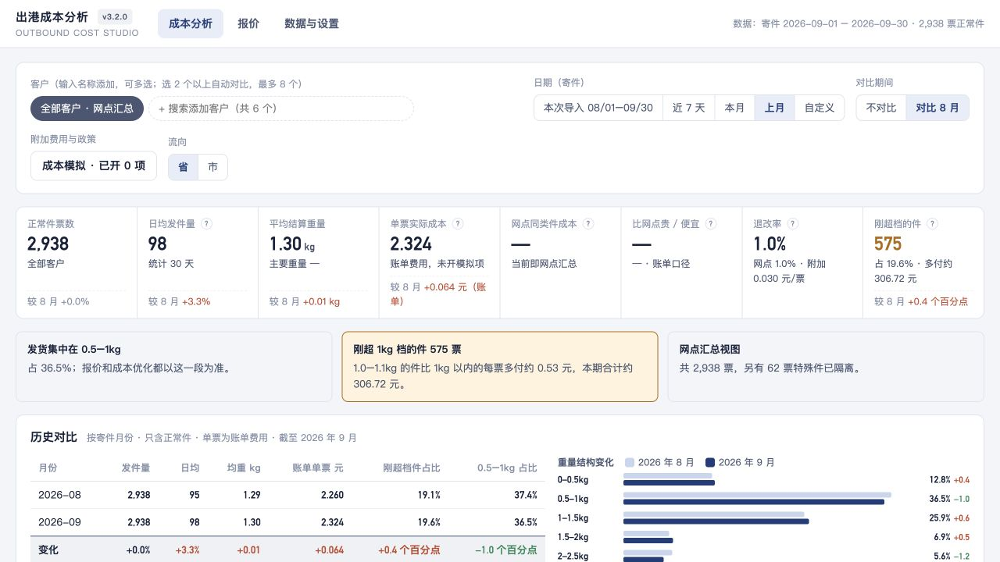

# 出港成本分析

在本机导入快递出港账单，分析客户、重量与流向成本，并生成报价。基于 Python、DuckDB 和原生 HTML/JavaScript，支持 macOS 与 Windows。



## 功能

- 多文件导入、去重、冲突核对及整次导入撤销。
- 正常件与特殊件隔离；客户分群、相似客户、成本矩阵及重量结构。
- 日均发件量、上期比较、最多六个月历史对比及排行变化。
- 自定义流向区域、统一排除范围、偏远区域单独报价。
- 港澳台默认关闭；打开后可按区域参与测算。
- 同一分析快照生成 全横向 A4 报告及分表数值 Excel。
- 深蓝/账簿主题、浅深色切换、键盘可用说明按钮。
- 12项可选成本模拟；按百分比或每票加价，支持批量调整、保存与导出。
- 浏览器只访问本机服务，业务数据保存在本地。

## 快速开始

准备 Python 3.12。在项目目录执行：

```sh
python -m pip install duckdb==1.5.6 python-calamine==0.8.3
python server.py
```

浏览器打开 `http://127.0.0.1:8888/`。首次没有数据，请在“数据与设置”上传 `.xlsx` 出港账单。需要指定目录或端口：

```sh
python server.py --port 8890 --data ./data-test --no-browser
```

生成虚构演示文件（两个月、6000行、6个虚构客户）：

```sh
python scripts/make_demo_data.py
```

然后导入 `outputs/演示出港账单.xlsx`。README截图仅使用此生成器的虚构数据。具体口径见 [使用说明](使用说明.md)。演示数据和真实数据请使用不同的 `--data` 目录。

## 开发与测试

```sh
python scripts/build_web.py
python -m unittest discover -s tests -p 'test_*.py'
node --test tests/test_v3_ui.cjs
```

测试只写入临时目录。源码不包含业务库、真实客户样本、第三方运行时、安装包或内部协作文档。

## 打包

`build_packages.py` 按允许清单构建离线ZIP；打包前需要自行准备合法可分发的 Python 3.12 运行时（不入Git）：

- Mac Apple Silicon：独立可重定位的Python安装目录放入 `runtime-mac/`，含 `bin/python3` 和 `lib/python3.12/site-packages`。
- Windows x64：Python官方embedded发行版解压到 `runtime-windows/`，在 `python312._pth` 中启用 `Lib/site-packages` 和 `import site`。
- 安装锁定的DuckDB、python-calamine运行时依赖。`python build_packages.py --install-deps` 会从PyPI读取与脚本内哈希相符的目标平台wheel；校验脚本为 `scripts/check_dependencies.py`。
- 构建自有运行时需按其发行许可保留许可证。
- 执行 `python build_packages.py`；产物写入 `dist/`，含每个文件的SHA-256清单。

Mac与Windows分别在目标系统启动、导入、核算及导出验证后再发布。运行时或ZIP存在不代表已通过跨平台验收。

## 界面原型

`design/ui-preview/index.html` 是设计源文件。`data.js`、`history.js` 和内嵌预览不提交：它们可能包含客户数据。可对停止的演示数据库运行：

```sh
python design/ui-preview/build_data.py ./data-demo/v2 2026-09-01 2026-09-30 "演示数据"
python design/ui-preview/build.py
python -m http.server 8790 --directory design/ui-preview
```

日期按自己的演示数据月份调整；生成器会同时输出 `data.js` 与 `history.js`；日常开发以服务的历史API为准。不要用真实客户截图替换README演示截图。

## 数据隐私与发布

服务仅监听 `127.0.0.1`，没有外部上传或遥测。运行期不要求联网；依赖准备需要联网。备份、原始文件、库、日志可能含客户和财务信息，请自行控制访问。分享程序请使用空白安装包，分享报价请使用客户报价导出。

本地仓库不配置远程地址。公开发布前检查 `git ls-files` 和敏感内容扫描，确认没有数据和个人信息。

## 许可证与版本

[MIT](LICENSE) · 版权所有 wuxiaoxia88。变更见 [CHANGELOG](CHANGELOG.md)。应用版本和发布日期定义于 `v2/version.py`，发布时更新版本、CHANGELOG并建立对应Git标签。

## 服务部署与每日同步

v3.2.1 增加交件业务日（12:00–次日12:00）、每日出港账单同步、一致性备份与局域网 Host 白名单。单机使用方式不变；服务部署、迁移、守护、回滚和同步口径见 [部署与运维说明](docs/部署与运维说明.md)。v3.2.2 按创建时刻和精确行数关联唯一导出任务，缺失或多候选即失败报告，多日严格串行。每日同步脚本适用于目标 Mac，桌面离线分析仍支持 Mac 与 Windows。

## v3.4 加载与缓存

服务启动及导入、同步、撤销、配置变更后，按数据版本预热全部客户的上月、本月和本次导入分析。JSON 与脚本支持 gzip；前端只请求一份 bundle 和一份 CSS。排行前 30 名、分群摘要先显示，展开时读取同一分析快照。

前端源码为 `web/v34-*.js` 与 `web/v34.js`。修改后运行 `python scripts/build_web.py`，提交生成的 `web/v34.bundle.js`；打包会校验源码与 bundle 一致。测试时浏览器禁用静态资源缓存，发布时版本参数可长期缓存；业务 API 保持 `no-store`。后台同步后的无未保存设置的分析页每 30 秒检查数据版本，获得焦点时也检查。
